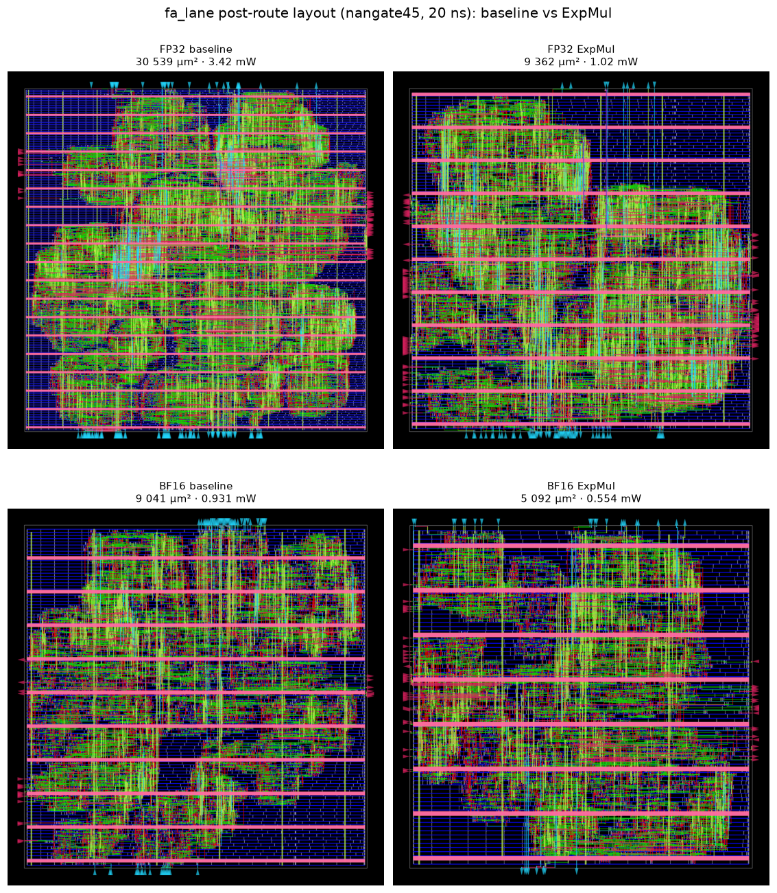

# Fused Exponential–Multiplication Operators for FlashAttention-2

Reproduction of

> K. Alexandridis, V. Titopoulos, and G. Dimitrakopoulos,
> “Low-Cost FlashAttention with Fused Exponential and Multiplication Hardware Operators,”
> arXiv:2505.14314 [cs.AR], May 2025 ·
> IEEE Xplore: <https://ieeexplore.ieee.org/document/11130263> ·
> Reference implementation (MIT): <https://github.com/ic-lab-duth/Fused-ExpMul>

The paper replaces the scalar exponential and the subsequent vector multiplication of the
FlashAttention-2 inner loop with a single `ExpMul` operator, implemented as an integer
shift-and-add followed by an exponent-field update. The result is produced directly in
floating-point format, without a dequantisation step. The authors report **−28.8 % area** and
**−17.6 % power** in a 28 nm process.

This repository reproduces the operator, the kernel, the language-model evaluation and the
hardware flow, and documents where the reproduction agrees with and departs from the paper.
All reported numbers are generated by the code in this repository and stored under `results/`.

**Report notebook:** [`flash_attn_expmul.ipynb`](flash_attn_expmul.ipynb) — format report; every figure is computed when the notebook runs (the operator figures from the
Q6.10 definition, the rest from the committed result tables, the layouts rendered from the GDS files
with `gdstk`).

**Phase reports** (each available in English and Chinese):

| Phase | English | 中文 |
|---|---|---|
| 1 — ExpMul operator | [README_en](results/phase1/README_en.md) | [README_zh](results/phase1/README_zh.md) |
| 2 — FlashAttention-2 kernel | [README_en](results/phase2/README_en.md) | [README_zh](results/phase2/README_zh.md) |
| 3 — GLUE / Flan-T5 | [README_en](results/phase3/README_en.md) | [README_zh](results/phase3/README_zh.md) |
| 4 — Synthesis, P&R, power | [README_en](results/phase4/README_en.md) | [README_zh](results/phase4/README_zh.md) |
| Visuals and layouts | [README_en](results/visuals/README_en.md) | [README_zh](results/visuals/README_zh.md) |

---

## Key results

| Quantity | Baseline | ExpMul | Change |
|---|---|---|---|
| Operator error vs. exact $e^xV$ (RMS) | — | 21.2 % exponent-only / **3.3 %** mantissa-interpolated | — |
| FA-2 kernel error, $d{=}64$, $N{=}512$, FP32 | 0.08 % | 22.5 % / **5.1 %** | — |
| FA-2 kernel error, $d{=}64$, $N{=}512$, BF16 | 14.4 % | **12.0 %** (mantissa-interpolated) | — |
| Lane area, FP32 (post-route, 45 nm) | 30 539 µm² | 9 362 µm² | **−69.3 %** |
| Lane power, FP32 (post-route, VCD, 50 MHz) | 3.42 mW | 1.02 mW | **−70.2 %** |
| Lane area, BF16 | 9 041 µm² | 5 092 µm² | **−43.7 %** |
| Lane power, BF16 | 0.931 mW | 0.554 mW | **−40.5 %** |




---

## Method in brief

**FlashAttention-2 (Algorithm 2)** is kept unchanged in order:

```
s_i = <q,k_i>;  m_i = max(m_{i-1}, s_i)
l_i = l_{i-1}·e^{m_{i-1}-m_i} + e^{s_i-m_i}
o_i = o_{i-1}·e^{m_{i-1}-m_i} + v_i·e^{s_i-m_i};   attn = o_N / l_N
```

Merging the running sum and output into $\sigma^*=[\ell,o]$ and $v^*=[1,v]$ gives
$\sigma^*_i=\mathrm{ExpMul}(m_{i-1}-m_i,\sigma^*_{i-1})+\mathrm{ExpMul}(s_i-m_i,v^*_i)$.

**ExpMul (Algorithm 3)** with $x\le 0$:

```
x_hat = Fixed(Clip(x,-15,0))                  # Q6.10, 16-bit
S     = x_hat + (x_hat>>1) - (x_hat>>4)       # ≈ -x·log2(e)
L     = round(-S / 2^10)                      # integer binary steps
Out   = Float(S_V, E_V - L, M_V)              # exponent-field update, underflow → 0
```

Two implementations of the last step are provided and evaluated separately:

| Variant | Description | Kernel-level error |
|---|---|---|
| `EXPMUL_EXPONENT` | Algorithm 3 as written: exponent field only | 15–22 % |
| `EXPMUL_MANTISSA` | The released implementation: the fractional residual is folded into the mantissa by an integer add | 2–5 % |

Only the second variant is consistent with the accuracy reported in the paper's Table I; the first
is retained because it is the literal reading of the algorithm and is the cheaper of the two.

---

## Hardware flow

- **RTL** (`rtl/`): IEEE-754 binary32 multiply/add (round-to-nearest-even, flush-to-zero),
  `ExpMul` (both variants), an 8-segment piecewise-linear exponential for the baseline,
  a pipelined $D$-lane kernel with single-cycle $\sigma^*$ update, and BF16 equivalents.
- **Synthesis**: Yosys + ABC against `nangate45` (45 nm). No open 28 nm PDK exists, so only
  relative savings are claimed; 45 nm absolute areas are about $2.6\times$ the 28 nm values.
- **P&R**: OpenROAD-flow-scripts, complete RTL-to-GDS for four lane designs.
- **Power**: a behavioural model of the library is generated from Liberty, the post-route netlist
  is simulated with random stimulus, and the resulting VCD is annotated in OpenROAD together with
  the extracted SPEF. Measured at 50 MHz (2 ns cannot be closed in 45 nm; worst slack ≈ −15 ns).

Block-level area, composed from the synthesised primitives (dot-product tree, $D$ update lanes,
final division):

| $d$ | Baseline (µm²) | ExpMul (µm²) | Saving | Paper (FP32) |
|---|---|---|---|---|
| 16 | 317 870 | 206 395 | **35.1 %** | 23.6 % |
| 32 | 626 949 | 412 640 | **34.2 %** | — |
| 64 | 1 245 107 | 825 132 | **33.7 %** | 29.7 % |
| 256 | 4 954 058 | 3 300 081 | **33.4 %** | 33.1 % |

The saving exceeds the reported 28.8 % because the composed model omits the fixed overheads
(control, registers, multiplexing) present in the paper's HLS block.

---

## Repository layout

```
.
├── flash_attn_expmul.ipynb     report notebook
├── README.md
├── paper/                      paper snapshot, extracted text, figures
├── src/                        C++ models (HLS style)
│   ├── expmul.hpp/.cpp         ExpMul operator, bit-accurate, FP32 and BF16
│   ├── exp_pwl.hpp             baseline piecewise-linear exponential
│   ├── flash_attn_kernel.hpp   shared FlashAttention-2 driver
│   ├── flash_attn_baseline.cpp / flash_attn_expmul.cpp
│   └── tb.cpp                  shared testbench for both kernels
├── rtl/                        synthesizable Verilog
│   ├── fp32_funcs.vh, fp32_mul.v, fp32_add.v
│   ├── expmul.v, exp_pwl.v, fa_kernel.v, fa_lane.v
│   └── bf16_funcs.vh, bf16_ops.v, fa_lane_bf16.v
├── model/                      Python: bit-exact model, plotting, GLUE harness, notebook generator
├── scripts/                    build, simulation, synthesis, P&R, VCD power, data/model fetch
└── results/
    ├── phase1/ … phase4/       reports, CSV/JSON data, figures
    └── visuals/                40 ORFS stage images, layout comparisons, 4 GDS files
```

---

## Reproduction

```bash
# C++ models (MSVC or g++)
powershell -File scripts/build.ps1          # Windows
bash scripts/build.sh                       # Linux
./build/expmul results/phase1               # operator error study
./build/tb results/phase2                   # kernel comparison
python model/expmul_ref.py --check results/phase1/expmul_pairs.csv

# RTL
iverilog -I rtl -o sim rtl/fp32_mul.v rtl/fp32_add.v rtl/exp_pwl.v rtl/expmul.v rtl/tb_exp.v

# Hardware (inside the OpenROAD-flow-scripts container)
bash scripts/synth_units.sh                 # primitive areas
python model/area_model.py                  # composed block area
bash scripts/setup_orfs_bf16.sh             # install designs
bash scripts/power_bf16.sh                  # VCD-based power

# GLUE / Flan-T5
venv/bin/python t5_glue.py --model models/flan-t5-base --data_dir data/glue \
    --n 100 --variants fp32 fp32_exp fp32_mi bf16 bf16_mi
```

Reproducibility: fixed seeds (20250520 for the C++ sweeps, 777 for stability, 424242 for the
per-query detail); tool versions are listed in §2 of the notebook.

---

## Notes and limitations

1. **Process.** No open 28 nm PDK is available; `nangate45` (45 nm) is used and only relative
   savings are claimed. Absolute areas scale by roughly $(45/28)^2$.
2. **Power scope.** Power is measured for a single $\sigma^*$ update lane with real switching
   activity from gate-level simulation. The block-level figure of about −35 % is an extrapolation
   from the area share of the update path, not a measurement of a complete kernel.
3. **Language-model evidence.** One hundred examples per task cannot resolve differences below
   about eight percentage points; the paper's few-shot, full-length protocol would be required for
   a definitive comparison. The observed direction (mantissa-interpolated ≈ FP32, exponent-only
   slightly lower) is consistent with the kernel study.
4. **Variant distinction.** Results are reported for both readings of Algorithm 3 rather than for
   a single one, because they differ by an order of magnitude in accuracy.

---

## Use of AI assistants and of the OpenROAD toolchain

**AI assistance.** This reproduction was produced with an AI coding assistant (a DeepSeek model
running in the DeepSeek Harness agent environment). The assistant wrote the C++/Python/Verilog
sources, the build, simulation and analysis scripts, the ORFS configurations and the plotting code,
ran the sweeps, gate-level simulations and place-and-route jobs, and drafted this README and the
report notebook. The human author defined the study, chose to evaluate both readings of Algorithm 3,
reviewed every result, decided what is claimed, and is responsible for the contents.

Machine-written artefacts are never trusted on assertion alone: the C++ operator is bit-exact
against an independently written NumPy model on 100 000 vectors, the RTL multiplier/adder against
NumPy on 4 000 vectors, and the RTL ExpMul on 5 000 vectors per mode. Every number in the tables is
read from a committed file under `results/`, and every figure in the notebook is regenerated when
the notebook runs.

**Toolchain.** All hardware results were produced with
[OpenROAD-flow-scripts](https://github.com/The-OpenROAD-Project/OpenROAD-flow-scripts) (ORFS), the
open-source RTL-to-GDS flow of the OpenROAD Project, on its `nangate45` platform (45 nm, 1.1 V):

| Stage | Tool |
|---|---|
| Synthesis | Yosys 0.68 + ABC, mapped to the Nangate OpenCellLibrary |
| Floorplan, placement, CTS, global/detailed routing, SPEF, reports | OpenROAD, driven by the ORFS `make` targets |
| Switching-activity power | gate-level VCD (Icarus Verilog) annotated with `read_vcd` + `report_power`, together with the extracted SPEF |
| GDS | written by the flow (`6_final.gds`), rendered with `gdstk` |

The flow is driven from `scripts/setup_orfs_*.sh`, `scripts/gen_vcd*.sh` and `scripts/power_*.sh`;
no commercial EDA tool was used at any point.

---

## License and citation

Released under the MIT License (see `LICENSE`). If you use this code, please cite the original
paper:

```bibtex
@article{alexandridis2025expmul,
  title   = {Low-Cost FlashAttention with Fused Exponential and Multiplication
             Hardware Operators},
  author  = {Alexandridis, Kosmas and Titopoulos, Vasileios and Dimitrakopoulos, Giorgos},
  journal = {arXiv preprint arXiv:2505.14314},
  year    = {2025}
}
```

**Tools.** [ORFS / OpenROAD](https://github.com/The-OpenROAD-Project/OpenROAD-flow-scripts)
(Apache-2.0) · [Yosys](https://yosyshq.net/yosys/) (ISC) · [gdstk](https://github.com/heitzmann/gdstk)
(BSL-1.0) · Icarus Verilog (GPL-2.0) · nangate45 open-cell library (academic use).
