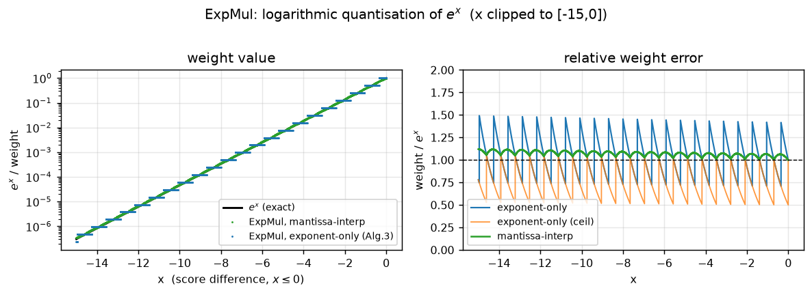
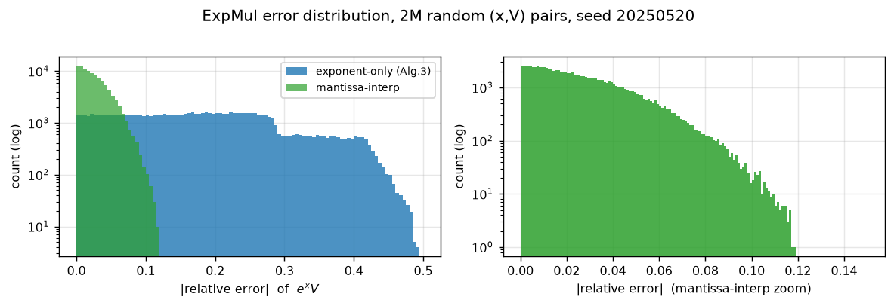
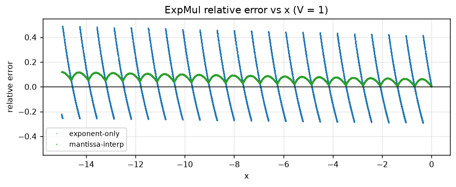

# 阶段 1：ExpMul 算子实现与误差测试

[English](README_en.md) | **中文**

对应论文 **Alg.3 / Eq.(4)–(9)**：
`ExpMul(x, V) = e^x · V`，其中 `x ≤ 0`。

## 1. 数学定义（严格按论文）

```
x_clip = Clip(x, -15, 0)                    # e^-15 = 3.06e-7，再小已无意义
x_hat  = Fixed(x_clip)                       # 16-bit 定点：6 位整数 + 10 位小数（Q6.10）
S      = x_hat + (x_hat >> 1) - (x_hat >> 4) # ≈ -x·log2(e)，Q6.10（1.4375 ≈ log2 e）
L      = -S / 2^10   （取整）                # 整数个 2^-1 步长
Out[i] = Float(S_V, E_V - L, M_V)            # 只改指数域；E_V - L <= 0 时输出 0
```

`L` 必须是**整数**：Eq.(9) 把它当作浮点数的指数偏移量。`x_hat` 是 Q6.10，
所以 `S` 也是 Q6.10；`−S/2^10` 才是“多少个 2 的幂”。实现中即 `L = (p + 512) >> 10`，
`p = -S ≥ 0`（round-to-nearest）。论文正文也明确写的是 “returns its **rounded** negative value”。

> 说明：论文 Alg.3 第 6 行写作 `−⌊x̂ + x̂≫1 − x̂≫4⌉`，`⌊·⌉` 是四舍五入符号。
> 若按字面把 `⌊·⌋` 当作向下取整再除以 2^10，得到的是 `ceil(−x·log2 e)`（本仓库的
> `LOG2EXP_CEIL` 变体），它会把所有权重系统性压低（平均 −0.49 个 2 的幂，见下表）。
> 两种读法都实现了，默认用四舍五入。

定点范围校核：`x_hat ∈ [-15360, 0]`（16-bit 有符号），`S ∈ [-22080, 0]`，
`p ≤ 22080 → L ≤ 22`，恰好落在 6 位整数能覆盖的 `x·log2 e ∈ [-21.64, 0]` 区间内。

## 2. 三个实现变体（同一测试平台）

| 变体 | 定义 | 说明 |
|---|---|---|
| `exp_only_near` | Alg.3 字面实现，`L` 四舍五入 | **用户指定的主实现**；结果只由指数域决定 |
| `exp_only_ceil` | `L = ceil(-x·log2 e)` | Alg.3 `⌊·⌋` 的字面读法，仅作消融 |
| `mantissa_int` | `bits(V) − round(p·2^M/2^10)`（`M`=23/7） | 论文**官方仓库** [15] 的整数加法形式：整数部分移动指数、小数部分在尾数上线性插值，仍是纯整数移位加、无 dequantization |

第三个变体不是“额外精度补丁”，而是论文公开 HLS 代码（`fused_operators.h::mitchExpMul`）
实际做的操作——它把 `x_eff` 直接加到 V 的整数表示上。论文 Alg.3 只写了指数域，
丢掉了这一步的尾数进位；两者硬件代价几乎相同（一次整数减法 vs 域提取+域插入）。

## 3. 误差结果（2,000,000 组随机 (x, V)，seed 20250520）

`x ~ 0.45·U[-4,0] + 0.30·U[-10,0] + 0.25·U[-15,0]`，`V` 随机符号 + 指数 ∈ [60,190] + 随机尾数。

| 变体 | mean | RMS | p50 | p90 | p99 | max | 相对误差 ≤5% 占比 |
|---|---|---|---|---|---|---|---|
| `exp_only_near` | +0.0000 | **0.2117** | 0.1749 | 0.3412 | 0.4298 | 0.4925 | 14.1% |
| `exp_only_ceil` | +0.0003 | 0.3091 | 0.2897 | 0.4572 | 0.4913 | 0.4998 | 9.1% |
| `mantissa_int` | −0.0000 | **0.0331** | 0.0221 | 0.0547 | 0.0855 | 0.1202 | 86.7% |

- 指数域版本的误差来自“把权重量化到 2 的整数次幂”，比值落在 `[2^-0.5, 2^0.5]`，
  RMS 21% 是该方法的下限，不是实现 bug。
- 尾数插值版把误差压到 3.3%（理论为分段线性近似 2^−f 的锯齿误差，最大 ~11%）。
- `L` 与理想值 `round(-x·log2 e)` 完全一致的比例：**97.79%**，平均 `|ΔL| = 0.022`。
- 权重 == 1（`L = 0`）的比例 5.5%：即 `x ∈ (-0.35, 0]` 时不做缩放。

### 按 |x| 分段（`exp_only_near`）

| \|x\| | 样本数 | mean | RMS | max | E\|ΔL\| |
|---|---|---|---|---|---|
| 10–15 | 166 651 | −0.00033 | 0.2284 | 0.4925 | 0.0703 |
| 7–10 | 280 335 | −0.00031 | 0.2159 | 0.4626 | 0.0400 |
| 4–7 | 279 497 | +0.00033 | 0.2047 | 0.4471 | 0.0265 |
| 2–4 | 636 912 | +0.00012 | 0.2108 | 0.4333 | 0.0161 |
| 1–2 | 318 794 | +0.00022 | 0.2155 | 0.4226 | 0.0097 |
| 0.5–1 | 158 964 | −0.00003 | 0.1688 | 0.3591 | 0.0000 |
| 0–0.5 | 158 847 | −0.00019 | 0.2322 | 0.4164 | 0.0031 |

`|ΔL|` 随 |x| 增大而增大，是常数 1.4375 与 log2 e = 1.4427 的偏差（0.005·|x| 个 2 的幂）。

## 4. 边界用例

| 用例 | x | V | Out | 结论 |
|---|---|---|---|---|
| 恒等 | 0 | 1.0 | 1.0 | `x = 0 → Out ≡ V`（逐位一致） |
| 忽略负零 | −0.0 | 1.0 | 1.0 | 同上 |
| 极小负 | −1e-9 | 1.0 | 1.0 | `L = 0` |
| 裁剪下界 | −15 | 1.0 | 2.384e-7 | `L = 22`，`2^-22/e^-15 = 0.78` |
| 越界裁剪 | −20 | 1.0 | 2.384e-7 | 与 −15 一致，不会更小 |
| 正数（非法输入） | +3 | 1.0 | 1.0 | 被 clip 成 0，**不产生正指数溢出** |
| NaN | NaN | 1.0 | 1.0 | clip 分支把 NaN 归到 0，输出有限 |
| 定点下溢 | −1 | `FLT_MIN` | 0 | `E_V − L = 0` → 次正规 → 冲刷为 0 |
| 次正规输入 | 0 | 1e-40 | 0 | 输入非规格化直接输出 0 |
| 最大正规数 | −15 | `FLT_MAX` | 8.11e31 | 指数 254−22=232，无溢出 |
| Inf | 0 | +Inf | +Inf | 透传 |

不变式（已断言通过）：`x = 0` 时逐位恒等；`|Out| ≤ |V|`；
`L(x)` 在 [−15, 0] 上单调（x 增大时不增）；随机测试中**从未产生 NaN/Inf**。

## 5. 验证

- **C++ ↔ Python 位精确**：10 万组 (x, V) 的 `L`、输出 bit pattern 全部一致
  （`python model/expmul_ref.py --check results/phase1/expmul_pairs.csv`）。
- 两种实现独立写成（C++ 用 `int16_t`/位域，Python 用 numpy 向量化），可交叉发现移位符号、
  舍入方向类错误。
- 复现命令、种子、编译器见本目录 `expmul_run.log` 与根 `README.md`。

## 6. 图







## 7. 从算子误差到 attention 误差（numpy 预探）

同一组随机 `q,k,v`（d=64，N=128/512），用 `2^-L` 作 softmax 权重、`o/l` 归一化后
比较 attention 输出（`tools/probe_attention_error.py`）：

| 配置 | 指数域 ExpMul | 尾数插值 ExpMul | 平均最大权重 |
|---|---|---|---|
| d=64, N=128, 温度 1× | 15.8% | **2.50%** | 0.074 |
| d=64, N=512 | 17.4% | **2.25%** | 0.026 |
| d=64, N=128, 温度 2× | 11.8% | **2.92%** | 0.242 |

误差被 `o/l` 归一化显著吸收（21% → 16%），但指数域版本仍有 ~16% 的 attention 输出误差；
尾数插值版只有 ~2.5%。这解释了为什么论文 Table I 能做到与 FP32 基本一致——
**官方实现带尾数进位**。阶段 2 会用可综合 kernel 复核这两个数字。

## 8. 结论 / 对阶段 2 的输入

1. 指数域 ExpMul（Alg.3 字面）在**单元素**上 RMS 21%，这是对数重量化的固有代价；
   单元素误差经 `o/l` 归一化后降到 ~16%（attention 输出），仍需在阶段 2 用完整 kernel 复核。
2. 官方仓库的尾数插值形式 RMS 3.3%、attention 输出 ~2.5%，硬件只多一次整数加法；
   阶段 2/3 会把它作为 “paper-equivalent” 变体一起评估。
3. 阶段 2 将用同一套 (q,k,v) 比较：`baseline(exp_pwl + FP mul)` vs
   `exp_only` vs `mantissa_int`，并给出 attention 输出相对误差分布。
