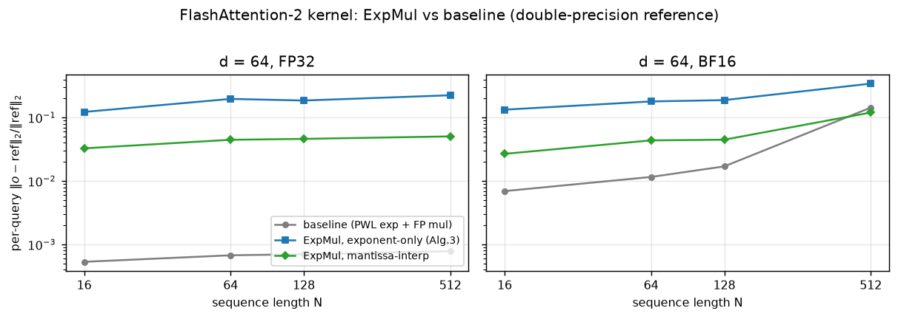
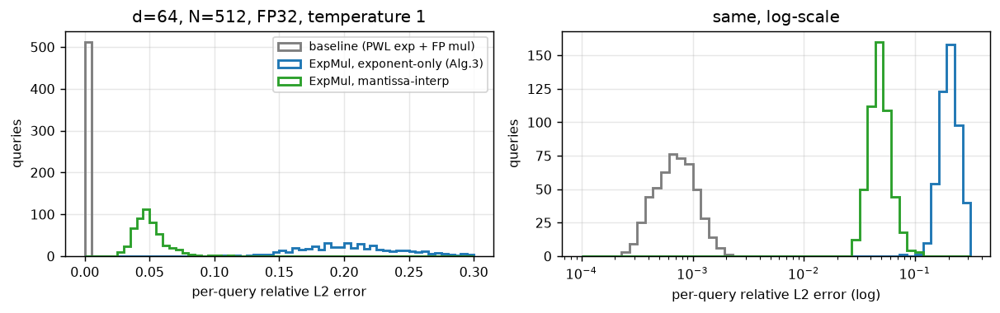

# 阶段 2：ExpMul 集成进 FlashAttention-2 kernel

[English](README_en.md) | **中文**

对应论文 **Alg.2 / Alg.4 / Eq.(2)(3)(5)**，以及 **Fig.1/Fig.2** 的块并行结构。

## 1. 实现结构（保证对比公平）

`src/flash_attn_kernel.hpp` 里只有一个 driver，两个版本**共用**：

```
fa2_driver<P, D, T>(Q, K, V, N, O, updater)
    ├─ P 个 query 预加载（对应 Fig.1 的 query block）
    ├─ for i in 0..N-1:  k_i, v_i 广播给 P 个 block
    │      s = dot(q, k_i)            # FP32 累加
    │      updater(state, s, v_i)     # ← 唯一区别
    └─ attn = o / l                   # 延迟除法
```

| | baseline (`flash_attn_baseline.cpp`) | ExpMul (`flash_attn_expmul.cpp`) |
|---|---|---|
| 更新 | `exp_pwl(m_prev-m)`、`exp_pwl(s-m)` 两个 exp 单元 | 两个 `ExpMul`，每个只算一次 `L` |
| 乘 | 每条 lane 2 次 FP32 乘 | 无 |
| 加 | 2 次 FP32 乘 + 1 次 FP32 加 / lane | 1 次整数指数更新 + 1 次 FP32 加 / lane |
| 循环顺序 | 完全相同 | 完全相同 |

- `sigma* = [l, o]`、`v* = [1, v]` 显式构造（`ExpMulUpdate`），所以 `l` 和 `o` 用的是同一条 ExpMul 流水线（Eq.3/5）。
- baseline 的 exp 单元：8 段分段线性 + 区间规约，输入同样裁剪到 [-15,0]，
  实测 **max 相对误差 0.094%、mean 0.063%**（`exp_unit_error.csv`）。
- BF16 版本：`ac::bfloat16` 语义，所有存储与运算按 bf16 舍入（与论文 HLS 代码一致）。

## 2. 功能正确性（vs 双精度参考，同一循环顺序）

指标：每条 query 的 `||o − ref||₂ / ||ref||₂`，N 条 query 取平均；随机 q,k,v（seed 20250520），
`q` 缩放使 score 标准差 = temperature。

| d=64, T=1 | N=16 | N=64 | N=128 | N=512 |
|---|---|---|---|---|
| baseline FP32 | 0.05% | 0.07% | 0.07% | **0.08%** |
| ExpMul 指数域（Alg.3） | 12.3% | 19.7% | 18.6% | 22.5% |
| ExpMul 尾数插值 | 3.28% | 4.47% | 4.62% | **5.06%** |
| baseline BF16 | 0.69% | 1.16% | 1.70% | 14.4% |
| ExpMul 指数域 BF16 | 13.3% | 18.0% | 18.9% | 34.3% |
| ExpMul 尾数插值 BF16 | 2.68% | 4.38% | 4.49% | 12.0% |

d=16/32 见 `errors_matrix.csv`，趋势相同（指数域 11–22%，尾数插值 2.3–5.1%）。

几点观察：

1. **指数域 ExpMul 的误差随 N 稳定在 12–22%**，与阶段 1 的算子级 RMS 21% 一致；
   `o/l` 归一化只吸收公共缩放，不吸收逐元素权重误差。
2. **尾数插值版 2–5%**，误差主要来自 `o` 累加器被反复 ExpMul（误差按乘法累积），
   而不是单次算子误差（单次 RMS 3.3%）。
3. BF16 的 baseline 在 N=512 反而比 ExpMul-MI 差（14.4% vs 12.0%）：bf16 每次舍入 PWL exp
   是**随机噪声**，而 ExpMul 的对数重量化是**平滑偏差**，在 `o/l` 里部分抵消。
4. 数值稳定性（FP32，d=64）：score 放大到 1e3/1e6 时三种实现的最大绝对误差都在 1e-5 量级，
   而**不去 max 的朴素 softmax 已溢出**（`naive_exp_overflow=1`）；全程无 NaN/Inf。
   `uniform`/`single_key` 用例分别验证了权重全相等、N=1 的边界。





## 3. 数值稳定性用例（节选，FP32）

| 用例 | 条件 | baseline | ExpMul 指数域 | ExpMul MI | 朴素 exp 溢出 |
|---|---|---|---|---|---|
| random | σ_score=1 | 7.4e-4 | 2.7e-1 | 4.2e-2 | 否 |
| huge_scores | σ_score=1e3 | 4.8e-6 | 3.2e-6 | 4.8e-6 | **是** |
| huge_scores | σ_score=1e6 | 3.4e-6 | 2.3e-6 | 3.4e-6 | **是** |
| uniform | 所有 score=0 | 1.5e-7 | 1.5e-7 | 1.5e-7 | 否 |
| single_key | N=1 | 0 | 0 | 0 | 否 |
| dominant_key | 第 0 个 key 主导 | 2.7e-4 | 1.2e-2 | 7.7e-3 | 否 |

所有用例 `nonfinite = 0`。huge_scores 下三种实现几乎逐位一致，因为 softmax 极度尖锐，
最大权重 `x = 0` 时 ExpMul 精确（`L = 0`）。

## 4. 块并行结构验证

`P=4`（4 个 query 并行，K/V 广播）与逐条 `P=1` 的结果 **逐位相同**（0 个 lane 不同，
`blocking_check.csv`），确认广播/预加载没有引入数值差异。

## 5. 结论

- 阶段 1 的算子级结论在 kernel 级复现：Alg.3 字面（指数域）在 FlashAttention 里
  会带来 ~15–20% 的输出误差，**不足以支撑论文 Table I 的“与 FP32 一致”**；
  尾数插值形式（官方仓库的实际做法）为 2–5%，是阶段 3 的候选。
- 阶段 3 将把两种 ExpMul 都接到 Flan-T5 的 attention 上跑 GLUE，用实测精度判断
  哪种才是论文方法的等价物。
- 硬件上两者只差一次整数加法，阶段 4 会分别给出 area/power。

## 6. 复现

```powershell
powershell -ExecutionPolicy Bypass -File scripts\build.ps1
.\build\tb.exe results\phase2
python model\plot_phase2.py
```

产物：`errors_matrix.csv`（3 变体 × 2 dtype × 3 d × 4 N × 2 温度）、
`detail_d64_N512_fp32.csv`（逐 query 误差）、`stability.csv`、`exp_unit_error.csv`、
`blocking_check.csv`、`phase2_stats.json`、`tb.log`。
