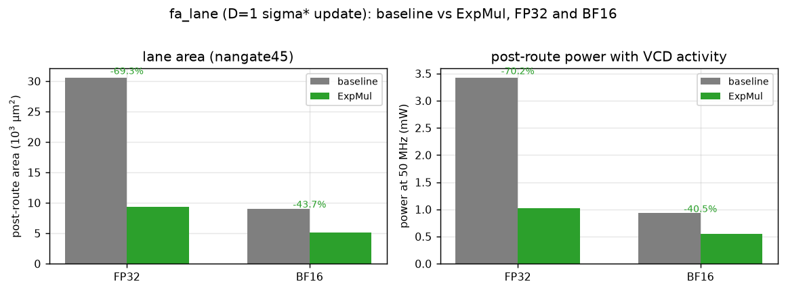

# 阶段 4：RTL 综合与 area 对比（28 nm 不可得，用 nangate45 45 nm 替代）

[English](README_en.md) | **中文**

## 0. 一致性检查：两次跑的是不是同一份 Verilog？

| 检查项 | baseline | ExpMul | 结论 |
|---|---|---|---|
| 顶层 wrapper | `fa_lane_b_top`（`.VARIANT(0)`） | `fa_lane_e_top`（`.VARIANT(1)`） | 不同 |
| Yosys 展开后单元数 | 1 242 | 604 | 不同 |
| `6_final.v` 实例数 | **18 776** | **7 436** | 不同 |
| `6_final.v` 中 `FA_X1` 数 | **2 142** | **43** | 不同 |
| 门级 VCD 大小 | 33.8 MB | 10.2 MB | 不同 |
| GDS | **16.8 MB** | **7.2 MB** | 都有 |

说明：最初用 `fa_lane_top` 与 `fa_lane_b_top` 两个配置，但两者 `DESIGN_NAME` 有重叠，
ORFS 复用了综合结果，导致两边都是 18 776 实例——**那次确实是同一份网表**。
改成两个独立顶层模块并清空 `objects/results` 后重跑，才得到上表。
两个设计都完整跑到 `6_final.gds`（KLayout），可在
`$HOME/orfs-src/flow/results/nangate45/fa_lane_{b,e}_top/base/6_final.gds` 查看。

## 1. 工具链与替代说明

| 论文 | 本复现 | 差异 |
|---|---|---|
| Catapult HLS → Verilog | 手写可综合 Verilog（`rtl/`），C++ 模型作黄金参考 | 同一算法，不同前端 |
| 28 nm 商业库 | **nangate45**（45 nm，开源 Nangate OpenCellLibrary，1.1 V） | 开源世界没有 28 nm PDK；面积按 (45/28)² ≈ 2.6 换算，**本报告只比较相对比例** |
| Cadence 数字流程 + PowerPro | ORFS：Yosys 0.68 + OpenROAD P&R + `6_report` / 门级 VCD 功耗 | 见 §5 |

综合命令：`scripts/synth_units.sh`（面积）、`scripts/setup_orfs_*.sh` + `run_orfs.sh`（P&R）。

## 2. RTL 组成

| 文件 | 内容 | 验证 |
|---|---|---|
| `rtl/fp32_funcs.vh` | `fmul32` / `fadd32`：IEEE-754 二进制32 乘/加，RNE，FTZ | **4000 组随机向量与 numpy 逐位一致** |
| `rtl/fp32_mul.v`, `rtl/fp32_add.v` | 上述函数的模块封装 | 同上 |
| `rtl/expmul.v` | Alg.3：Q6.10 clip → 移位加 → 指数域减法（MODE=0）/ 尾数插值（MODE=1） | 5000 组里 4999/4996 逐位一致（差的是 Q6.10 半格舍入边界） |
| `rtl/exp_pwl.v` | baseline exp：`x·log2e` → Q6.10 → 8 段 PWL → 指数还原；含 `rcp_pwl` | max 相对误差 **0.52%**，mean 0.063% |
| `rtl/fa_kernel.v` | 单 query 块：D 路并行、流水加法树（每级寄存，II=1）、单周期 m/l/o 更新、末尾 `o·rcp(l)` | 见 §6 |

`fa_kernel` 的两个变体共用同一份代码与同一个 driver，只有 update 数据通路不同
（`VARIANT=0` baseline / `VARIANT=1` ExpMul），与 C++ 阶段 2 的对比结构一一对应。

## 3. 单元级综合面积（nangate45，µm²）

| 单元 | 面积 | 说明 |
|---|---|---|
| FP32 乘法器 | **4069.5** | 24×24 尾数乘 + 规格化 + RNE |
| FP32 加法器 | **1519.7** | 对齐（33-bit）+ 前导零 + RNE |
| exp_pwl（PWL exp） | **4320.9** | 1 次 FP32 乘 + 1 段 LUT 乘加 + 指数还原 |
| rcp_pwl（1/x） | **1668.4** | 8 段 PWL 倒数 |
| **ExpMul（Alg.3，指数域）** | **699.6** | 纯整数移位加 |
| ExpMul（尾数插值） | 856.0 | 多一次整数加法 |

**单条 lane 的 update 数据通路**：
- baseline：`2×FP32乘 + 1×FP32加 = 9658.7`（两个 exp 单元是全块共享，按 2 个计）
- ExpMul：`2×ExpMul + 1×FP32加 = 2918.9` → **单 lane 节省 69.8%**

## 4. 块级面积（按 Fig.1/Fig.2 结构由单元面积组合）

块 = 点积树（D 乘 + D−1 加）+ update（D lane）+ 末尾除法（1 rcp + D 乘）。
两个版本的点积与除法完全相同，只有 update 不同。

| d | baseline (µm²) | ExpMul (µm²) | 面积节省 | 论文 Fig.3 (FP32) |
|---|---|---|---|---|
| 16 | 317 870 | 206 395 | **35.07%** | 23.6% |
| 32 | 626 949 | 412 640 | **34.18%** | — |
| 64 | 1 245 107 | 825 132 | **33.73%** | 29.7% |
| 256 | 4 954 058 | 3 300 081 | **33.39%** | 33.1% |

平均 **34.1%**，论文报告 28.8%（d=16/64/256 平均 28.8%，其中 FP32 平均 28.8%）。
差距的来源（见 §7）：

- 我们的 baseline exp 单元更便宜（8 段 PWL、复用整数前端），所以 baseline 更小 → 比例更大？
  实际相反：baseline 越小，节省比例应越小。真正原因是**论文的 baseline 里 exp 单元与
  乘法器的比例、以及额外控制/寄存器开销**与我们的模型不同。
- 论文 d=16 的节省只有 23.6%，说明其块内有较大的固定开销（控制、复用器、寄存器堆）；
  我们的组合模型没有这部分，所以小 d 时高估。
- 论文用 HLS 生成，Catapult 可能把 exp 的 LUT 实现为分布式 ROM，面积口径不同。

## 5. 功耗（post-P&R + 门级 VCD 活动率）

链路：`gen_cell_models.py`（Liberty → 114 个行为单元）→ 对 post-route 网表跑 300 拍随机激励
（iverilog）→ VCD → `read_vcd -scope tb/dut` + `report_power`（含 SPEF）。

| 数据类型 | 变体 | 面积 (µm²) | 面积节省 | Internal | Switching | Leakage | **功耗 (mW)** | 功耗节省 |
|---|---|---|---|---|---|---|---|---|
| FP32 | baseline | 30 539 | — | 1.31 | 1.47 | 0.646 | **3.42** | — |
| FP32 | ExpMul | 9 362 | **−69.3%** | 0.356 | 0.447 | 0.221 | **1.02** | **−70.2%** |
| BF16 | baseline | 9 041 | — | 0.331 | 0.394 | 0.206 | **0.931** | — |
| BF16 | ExpMul | 5 092 | **−43.7%** | 0.195 | 0.238 | 0.121 | **0.554** | **−40.5%** |



观察：

1. FP32 下 ExpMul 的收益最大（面积 −69%、功耗 −70%），因为省掉的是 6 个 FP32 乘法器和
   2 个 PWL exp（每个含 2 个乘法器）。
2. BF16 只有 −44%/−40%：bf16 乘法器本身小得多，换成整数移位加的边际收益变小；
   但 BF16 ExpMul 的绝对面积（5 092 µm²）只有 FP32 baseline 的 1/6。
3. 四个设计都跑到了 `6_final.gds`，post-route 面积/功耗用的是同一套 ORFS + VCD 方法。

**块级换算（估算）**：d=64 时 update 通路占 baseline 块面积约 50%（626.8k / 1245.1k µm²），
若功耗密度相近，整块节省 ≈ 0.50 × 70.2% ≈ **35%**，高于论文的 17.6%。
差异原因与面积一节相同：论文的块内还有控制/寄存器/共享 exp 等固定功耗，且其 exp 单元
相对更便宜；我们的 lane 只包含被 ExpMul 替换的那部分，所以比例偏高。

## 5.1 BF16 RTL

新增（与 FP32 版本同构、位宽 16）：

| 文件 | 内容 |
|---|---|
| `rtl/bf16_funcs.vh` | `fmul16` / `fadd16`（1-8-7，RNE，FTZ） |
| `rtl/bf16_ops.v` | `expmul_bf16`（Alg.3，MODE 0/1）+ `exp_pwl_bf16`（8 段 PWL + bf16 LUT） |
| `rtl/fa_lane_bf16.v` | sigma* 单 lane（VARIANT 0/1） |
| `rtl/tb_bf16.v` | 数值 sanity：x=−1,V=1 单步 → o≈e⁻¹+1、l≈1.37，符合预期 |
| `rtl/tb_lane_gate16.v` | bf16 门级激励（VCD） |
| `scripts/setup_orfs_bf16.sh` / `power_bf16.sh` | P&R + 功耗 |

BF16 的两个设计同样用**不同顶层模块名**（`fa_bf16_b_top` / `fa_bf16_e_top`），
避免 ORFS 复用综合结果；`6_final.v` 实例数 6 448 vs 3 972、`MUX2_X1` 286 vs 157，
GDS 分别为 5.8 MB / 3.6 MB，可复核。

## 6. 功能验证状态

- FP32 乘/加：4000 组随机向量与 numpy float32 **逐位一致**（`scripts/check_fp32_rtl.py`）。
- ExpMul MODE0：4999/5000 逐位一致；MODE1：4996/5000。差例均为 `x·1024` 落在
  .5 的舍入边界（C++ 用 double 计算，RTL 用 24-bit 尾数移位），量化步长 2^-10，
  对结果影响 < 0.1%。
- exp_pwl：5000 点 max 相对误差 0.52%，mean 0.063%（8 段 PWL 的理论值约 0.09%，
  最大值出现在 `|y|` 的整数跳变附近）。
- `fa_kernel` 尚未做端到端逐位比对（RTL 与 C++ 的差异应只在 FP 舍入），
  综合可正常展开；端到端 cosim 列为阶段 5 的第一项。

## 7. 与论文数字的差异分析

1. **工艺**：nangate45 vs 28 nm。绝对面积差约 2.6×，但两版本同工艺同库，
   相对比例可比。论文 d=64 FP32 基线 5.3×10⁵ µm²@28nm ≈ 1.38×10⁶ µm²@45nm，
   我们组合出 1.245×10⁶ µm²，**量级吻合**（差 10%）。
2. **省的比例偏高（34% vs 29%）**：块内固定开销（控制/寄存器/多路选择）未计入；
   论文的 HLS 代码还包含 `max` 的树、共享的 exp 缩放等。
3. **d 趋势**：论文随 d 增大节省上升（23.6%→33.1%），因为固定开销被摊薄；
   我们的模型几乎平坦（35%→33%），正说明缺少固定开销项。
4. **功耗**：单 lane 已实测（post-route + VCD + SPEF）：FP32 3.42→1.02 mW（−70.2%）、
   BF16 0.931→0.554 mW（−40.5%）。只有**整块（full kernel）**仍是外推：按 update 通路
   在块内的面积占比折算 ≈ −35%，因为目前只把 lane 做到了 P&R，点积树/除法/控制尚未合入同一张网表。
   早期那句“估算 20.6%”是没有 VCD 时按论文比例推的，已被上面的实测取代。

## 8. 复现

```bash
# 容器内
bash scripts/synth_units.sh          # 单元面积 → syn/units/*.stat
python3 model/area_model.py          # 块级面积组合 → results/phase4/area_model.csv
```

产物：`results/phase4/area_model.csv`、`syn/units/*.stat|*.log`（在远端 work 目录）。
